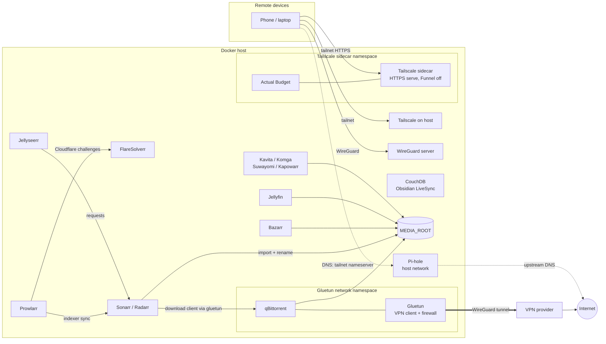

# Homelab

A single-host Docker Compose homelab with 22 services. The infrastructure is the focus:

- **VPN isolation**: the torrent client has no network path except an encrypted tunnel.
- **Network-wide DNS filtering** with Pi-hole, served to every device on the tailnet.
- **Two remote-access paths**: a WireGuard server, and Tailscale with an HTTPS-only sidecar.
- **Hands-off maintenance**: scheduled image updates and self-healing port forwarding.
- **Portable config**: every secret, port and host path lives in a gitignored `.env`.

On top of that run a media server, the *arr automation stack, a budgeting app, a notes-sync
backend, and an AV1 re-encode pipeline with measured quality and size trade-offs.

## Architecture



## Networking

### VPN isolation

qBittorrent runs with `network_mode: "service:gluetun"`, so it has no network interface of
its own. It shares Gluetun's network namespace, and Gluetun's built-in firewall only lets
traffic leave through the WireGuard tunnel. If the tunnel drops, torrent traffic stops; it
can't fall back to the home connection. The qBittorrent WebUI is published on the Gluetun
container, which is why Sonarr and Radarr reach their download client at the hostname
`gluetun`.

### DNS filtering

Pi-hole runs with host networking so it can bind DNS on the host and see real client
addresses. The tailnet's global nameserver points at this host, so every device on Tailscale
gets ad and tracker blocking wherever it is. Pi-hole's listening mode is `ALL` so it answers
queries that arrive on the tailnet interface, not only from the local subnet.

### Remote access

| Path | What it reaches | Notes |
| --- | --- | --- |
| WireGuard server | The home network | Per-device peer configs (`PEERS=phone,laptop`) |
| Tailscale on host | The host's services and file share | Identity-based; no inbound ports opened on the router |
| Tailscale sidecar | Actual Budget only | Own tailnet node with a Tailscale-issued HTTPS cert; Funnel disabled, so it is never on the public internet |

Actual shares the sidecar's network namespace (`network_mode: service:ts-actual-server`), the
same pattern used for qBittorrent and Gluetun.

## Automation

| Job | Schedule | What it does |
| --- | --- | --- |
| Watchtower | Daily, 4 AM | Pulls new images, recreates changed containers, removes old images |
| `update-port.sh` | Cron, every 5 min | Syncs the VPN's forwarded port into qBittorrent (see below) |
| `scripts/kavita-scan.sh` | Cron, every 20 min | Exchanges a long-lived API key for a short-lived JWT, then triggers an incremental library scan |
| Prowlarr | Continuous | Pushes indexer config to Sonarr and Radarr so indexers are managed in one place |

## Design decisions

**Allowlist `.gitignore`.** The repo root is the live Docker directory, and it holds app
databases, VPN and Tailscale state, WireGuard peer keys and logs. The `.gitignore` starts
with `/*` and opts specific files back in. A new file is private until it's deliberately
added, instead of public until someone remembers to ignore it.

**Everything host-specific in `.env`.** Secrets, published ports, the media path
(`MEDIA_ROOT`) and the timezone are all variables. `docker-compose.yml` and the scripts are
the same on any machine, and `.env.example` documents what each host has to supply.

**Watchtower on a schedule, not polling.** Updates land in one predictable low-traffic
window instead of whenever an upstream image changes, so a container doesn't restart in the
middle of a stream or a download. The trade-off is tracking `:latest`: an upstream breaking
change can land overnight. Recyclarr is the exception: it's pinned to major version 8, so
Watchtower applies its minor updates but never a breaking major upgrade.

**Self-healing port forwarding (`update-port.sh`).** The VPN provider assigns the forwarded
port dynamically, and it can change whenever the tunnel reconnects. Gluetun writes the
current port to a file in its mounted directory. Every 5 minutes the script:

1. Reads that file and exits non-zero if there's no port yet.
2. Logs into the qBittorrent WebUI API from inside the container (`docker exec`), so no
   credentials cross the network.
3. Compares qBittorrent's `listen_port` with the forwarded port and only writes on a
   mismatch.
4. Reads the setting back to confirm it, and logs one of `ALREADY_CORRECT`, `UPDATED`,
   `UPDATE_FAILED` or `LOGIN_FAILED`.

Without it, qBittorrent would keep advertising a dead port after a reconnect and lose
incoming peer connections without any error.

## AV1 re-encode pipeline

The goal is to shrink the video library without visible quality loss, and to only replace
files where the numbers justify it.

**Audit first.** A bitrate audit of about 89 movies found 68 that were already low-bitrate
encodes, with little left to gain from re-encoding. Only about 14 high-bitrate sources are
real AV1 candidates, so the pipeline targets those instead of the whole library.

**Server-side automation (this repo):**

- `av1_migrate.py` searches indexers through Radarr for AV1 releases of movies not yet in
  AV1, ranks them by seeders and grabs the best-seeded first. It also triggers series
  searches in Sonarr. Downloads still stalled after 10 minutes, or with an ETA over 12
  hours, are removed and blocklisted, and the next candidate is tried, up to 3 attempts.
- `av1_pipeline.py` stages lossless remuxes for local encoding. It keeps only one large
  download in flight and flags stalls for a manual decision.

**Encode settings, measured.** The pilot source was a 4K UHD Blu-ray remux (HEVC 10-bit,
78.6 Mbps). It was encoded on an RTX 4070 SUPER with `av1_nvenc`, and scored with libvmaf's
4K model against a lossless FFV1 reference clip, using frame-aligned comparisons. All
results are for one 60-second clip:

| Encoder setting | Size vs. source | VMAF (4K model) |
| --- | --- | --- |
| NVENC CQ19 | 118% (larger) | 99.2 |
| NVENC CQ23 | 41% | 96.8 |
| NVENC CQ27 | 39% | 96.7 |
| NVENC CQ31 | 26% | 96.0 |
| SVT-AV1 preset 5, CRF 28, film-grain 10 | 10% | 95.5\* |

\* VMAF isn't reliable for film-grain synthesis, so this result needs a visual check.

CQ19 came out larger than the source, most likely because the encoder spent bits
reproducing film grain. Above that, size drops steeply while VMAF stays above 96.

**Pass/fail rule.**

| VMAF | Result |
| --- | --- |
| 95 or higher | Pass |
| 90 to 95 | Manual review |
| Below 90 | Fail |

Per title, the plan is to use the lowest CQ that passes and is still at least 20% smaller
than the source. If no setting meets both, the original is kept. Sources are never
replaced automatically: passed encodes are staged and swapped in approved batches.

Status: the pilot is done. CQ23 is the leading setting, and CQ20 to CQ22 are still to be
tested. The library-wide run hasn't started, so there is no total storage figure yet. All
numbers above come from the pilot clip.

## Services

| Layer | Services |
| --- | --- |
| Networking and access | Gluetun, WireGuard, Tailscale (sidecar), Pi-hole |
| Automation | Watchtower, Prowlarr, Sonarr, Radarr, Bazarr, Recyclarr, Seadexerr, SeaDexArr, FlareSolverr |
| Apps | Jellyfin, Jellyseerr, qBittorrent, Actual Budget, CouchDB (Obsidian LiveSync) |
| Reading | Kavita, Komga, Suwayomi, Kapowarr |

## Setup

```sh
cp .env.example .env    # fill in secrets, ports, MEDIA_ROOT and TZ
docker compose up -d
```

Per-service config and data live next to the compose file (`./jellyfin/config`,
`./sonarr/config`, ...) and are gitignored. The cron jobs in [Automation](#automation) are
installed with `crontab -e`. The scripts load `.env` from the repo root, so they need no
other configuration.

`av1_pipeline.py` reads its queue from a local, gitignored `av1_remux_queue.json`, a list of
`{"movieId", "title", "type"}`.

## Repository layout

```
docker-compose.yml       all 22 services
.env.example             every variable the stack and scripts read
update-port.sh           VPN forwarded-port -> qBittorrent sync
scripts/kavita-scan.sh   scheduled Kavita library scan
av1_migrate.py           swap library files for AV1 releases
av1_pipeline.py          stage remuxes for local AV1 encoding
```
